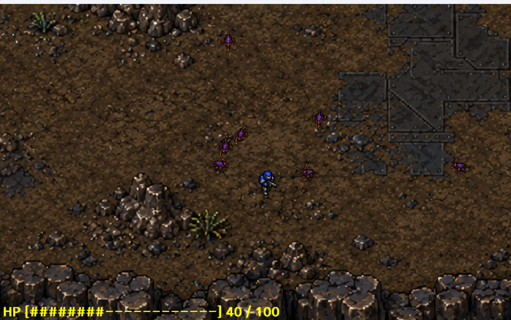
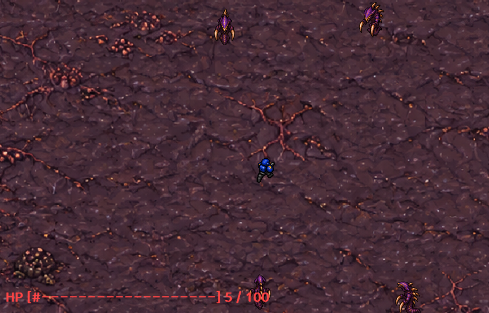
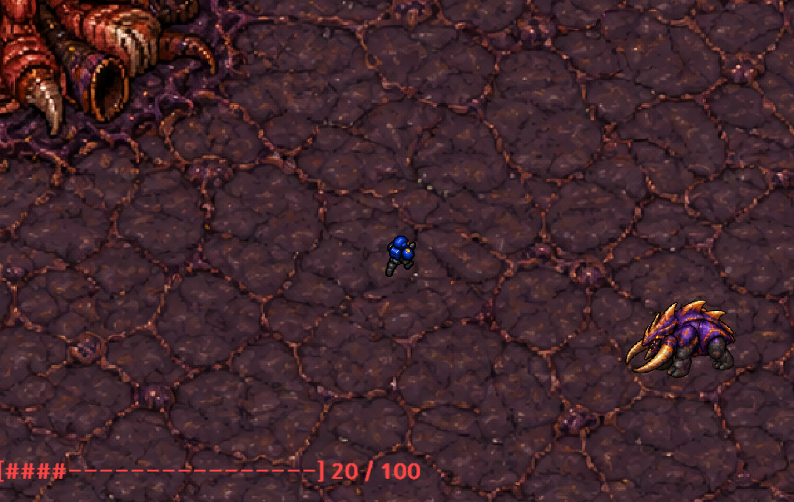
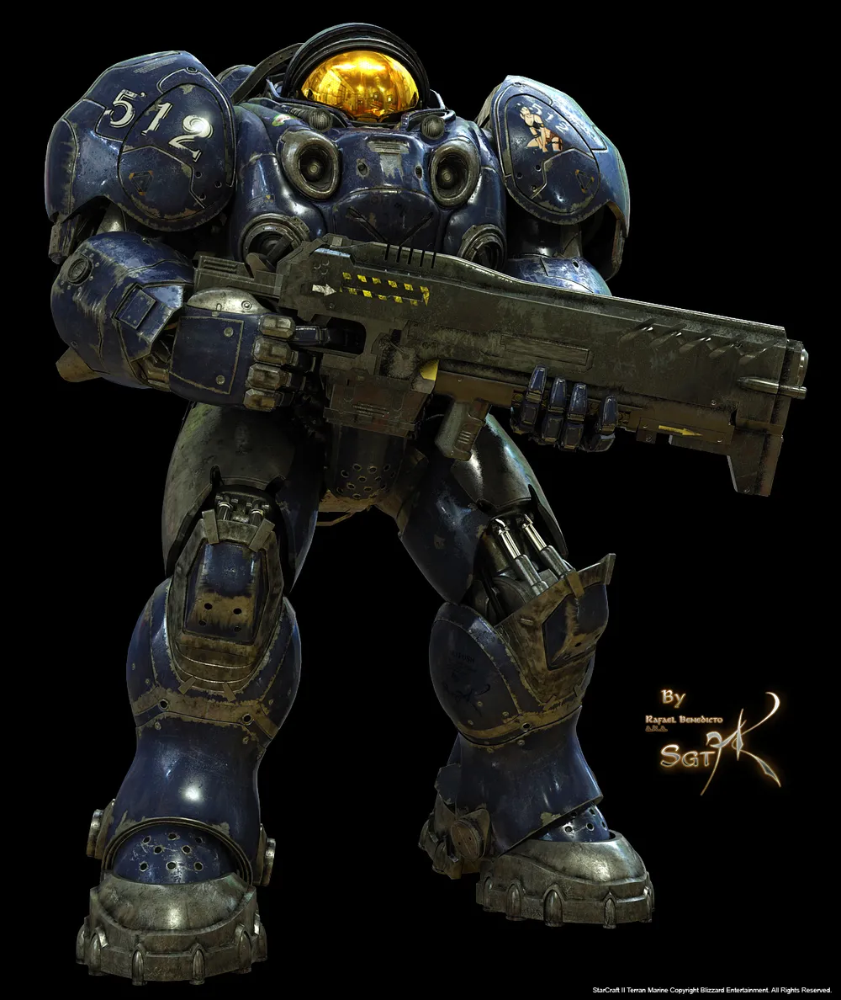
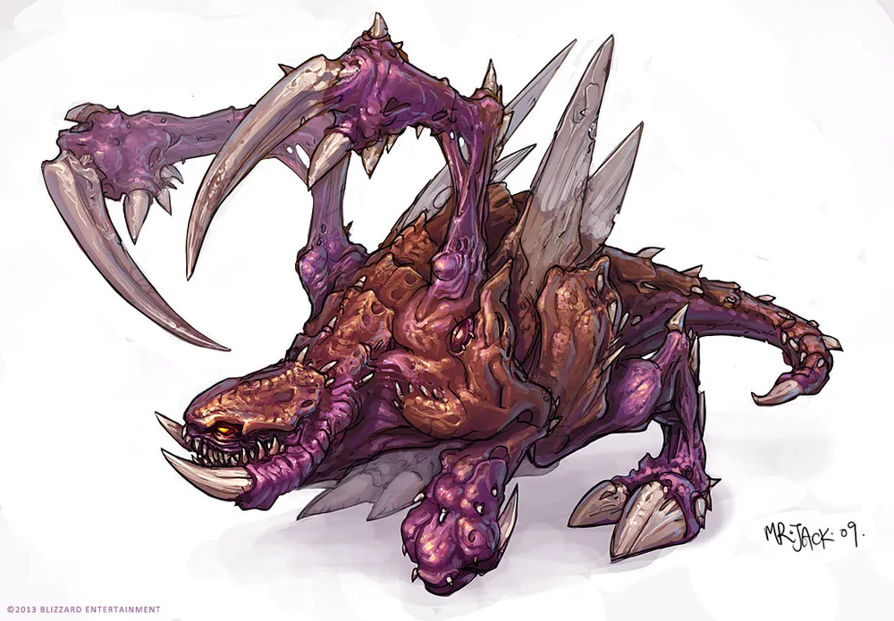
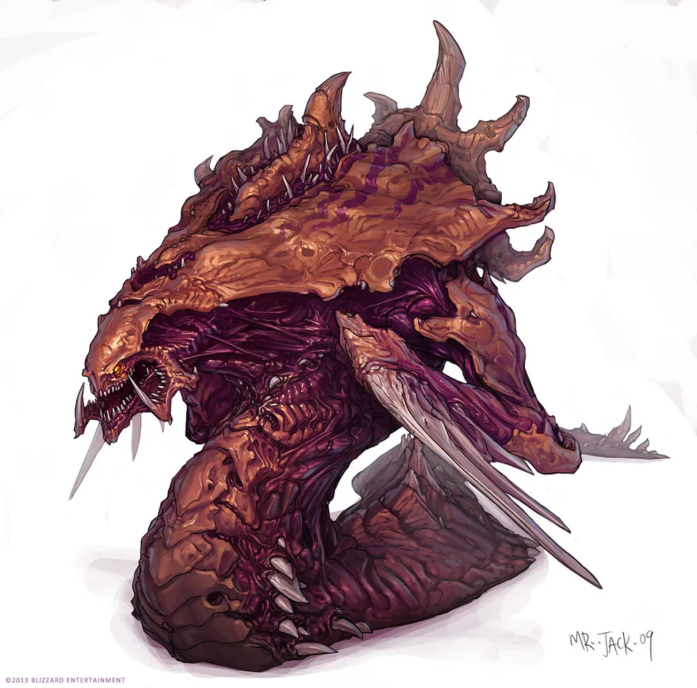
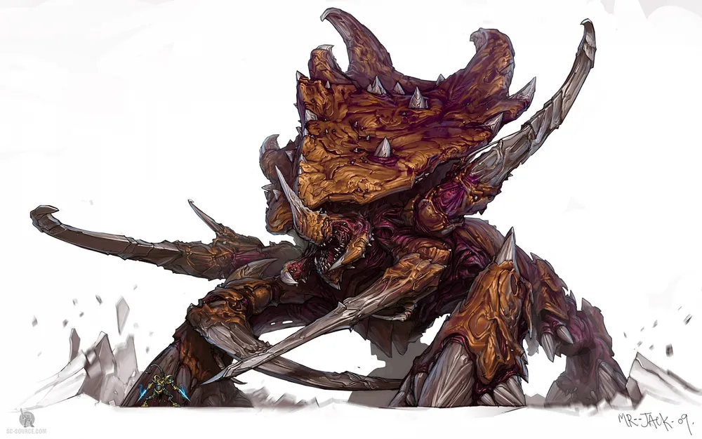
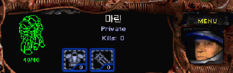

# OOOOOOO 게임 기획서
- 작성자: 김형욱
- 작성일: 2026.10.15
- 수정일1: 2026.10.22
- 수정일2: 2026.11.09

# 개요
- 제목 : STAR MARINE
- 장르
- 2D 탑다운 슈팅게임
- 마린을 직접 조종

# 시스템 기획 내용
---

## 플레이 방식
- WASD - 이동
- 마우스 좌 클릭 - 총 쏘기
- 스팀팩 기능 고민 중

## 스테이지 구성
1. 전진 배럭 - 저글링 출현

2. 점막 부근 - 히드라리스크 출현

3. 해처리 - 보스몹(울트라리스크) 출현

## 캐릭터 모델
- 마린/
- 저글링/
- 히드라리스크/
- 울트라리스크/

## ui 구성
- 고증에 맞춰서 스타1을 기준으로 해당 ui에 체력 및 탄환을 표시한다. 

## 주요 클래스 다이어그램
게임의 주요 클래스는 캐릭터 공통 기능을 담당하는 GameCharacter를 중심으로 구성된다.
플레이어 캐릭터인 GamePlayer, 일반 몬스터를 담당하는 GameMob, 보스 몬스터를 담당하는 GameBossMob이 이를 상속하여 각 캐릭터별 기능을 구현한다.
- GameCharacter
  - 캐릭터의 위치, HP, 데미지 처리 등 공통 기능을 담당한다.
  - GamePlayer, GameMob, GameBossMob의 부모 클래스이다.
- GamePlayer
  - 플레이어가 조작하는 마린을 담당한다.
  - WASD 이동, 마우스 방향 조준, 연속 사격, 총알 생성 및 적과의 충돌 판정을 처리한다.
- GameMob
  - 저글링, 히드라 등 일반 몬스터의 공통 기능을 담당한다.
  - 플레이어 추적, 8방향 이동 애니메이션, 공격 거리 판정, 공격 쿨타임, 피격 및 사망 기능을 처리한다.
  - 몬스터 종류에 따라 근접 공격과 원거리 공격을 구분한다.
- GameBossMob
  - 보스 몬스터의 기능을 담당한다.
  - 기본적인 이동 및 공격 기능은 GameMob과 동일하게 사용하며, 높은 체력과 공격력 등 보스 전용 능력치를 가진다.
- ScenePlay
  - 실제 게임 플레이 화면을 관리한다.
  - 스테이지 맵, 카메라, 충돌 영역, 플레이어와 몬스터의 생성 및 업데이트를 담당한다.
  - Stage 1, Stage 2, Stage 3의 진행을 관리한다.
- ScenePlayResult
  - 플레이어 사망 또는 보스 처치 후 결과 화면을 출력한다.
  - 승리 시 VICTORY, 패배 시 DEFEAT 화면을 출력한다.
클래스 관계는 다음과 같이 표현할 수 있다.

GameCharacter
→ GamePlayer

GameCharacter
→ GameMob
→ GameBossMob

ScenePlay
→ GamePlayer

ScenePlay
→ GameMob

ScenePlay
→ GameBossMob

## 주요 시퀀스 다이어그램
게임 플레이의 기본 흐름은 다음과 같다.

ScenePlay가 스테이지를 초기화한다.

플레이어와 스테이지에 필요한 몬스터를 생성한다.

플레이어가 WASD를 입력하면 GamePlayer가 이동한다.

마우스 위치를 기준으로 플레이어의 방향을 결정한다.

마우스 왼쪽 버튼을 누르면 총알을 생성한다.

몬스터는 플레이어와의 거리를 계산한다.

공격 범위 밖에 있으면 플레이어를 추적한다.

공격 범위 안에 들어오면 몬스터 종류에 맞는 공격을 수행한다.

플레이어 총알과 몬스터가 충돌하면 몬스터의 HP가 감소한다.

몬스터의 HP가 0이 되면 해당 몬스터는 사망한다.

플레이어가 스테이지 출구에 도달하면 다음 스테이지를 불러온다.

마지막 보스를 처치하면 승리 화면으로 이동한다.

플레이어 HP가 0이 되면 패배 화면으로 이동한다.
### 공격과 보상
플레이어는 마우스 방향으로 연속 사격을 할 수 있으며, 발사된 총알은 벽이나 바위 등의 지형과 충돌하면 제거된다. 총알이 몬스터에게 적중하면 몬스터의 HP가 감소한다.

몬스터는 종류에 따라 공격 방식이 다르다.

저글링

빠른 속도로 플레이어에게 접근한다.

일정 거리 안에 들어오면 근접 공격을 수행한다.

히드라

플레이어와 일정 거리를 유지한다.

공격 범위 안에 들어오면 이동을 멈추고 독침 형태의 투사체를 발사한다.

울트라리스크

이동 속도는 느리지만 높은 체력과 공격력을 가진다.

플레이어에게 접근한 뒤 강한 근접 공격을 수행한다.

적을 처치하면 해당 스테이지의 진행이 쉬워지며, 최종적으로 울트라리스크를 처치하는 것이 게임의 목표이다.
현재 버전에서는 별도의 점수나 아이템 보상보다 스테이지 진행 자체를 주요 보상으로 사용한다.

## Bosmob 클래스 구성
GameBossMob은 일반 몬스터보다 강한 보스 몬스터를 구현하기 위한 클래스이다.

현재 게임에서는 Stage 3의 울트라리스크가 보스 몬스터 역할을 한다.

GameBossMob은 일반 몬스터와 동일하게 다음 기능을 가진다.

플레이어 위치 추적

지형 충돌 판정

공격 범위 확인

공격 쿨타임 관리

피격 및 HP 감소

사망 처리

방향에 따른 스프라이트 출력

일반 몬스터와의 차이점은 높은 능력치이다.

울트라리스크의 주요 특징은 다음과 같다.

일반 몬스터보다 높은 최대 HP

느린 이동 속도

넓은 근접 공격 범위

높은 공격력

큰 캐릭터 크기와 충돌 범위

보스의 HP가 0이 되면 ScenePlay에서 보스 사망 여부를 확인하고, ScenePlayResult로 전환하여 VICTORY 화면을 출력한다.

향후 보스별 특수 공격이나 패턴을 추가할 경우 GameBossMob 클래스에 별도의 공격 패턴이나 상태를 추가하여 확장할 수 있다.