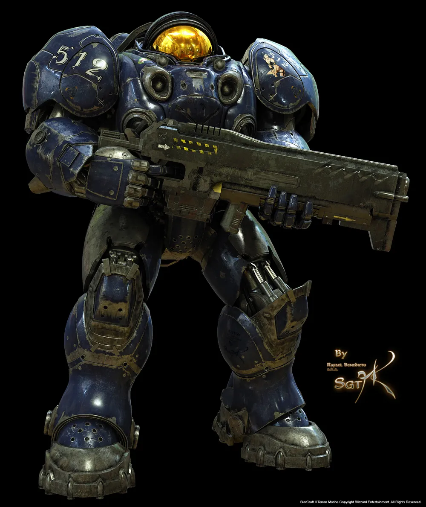
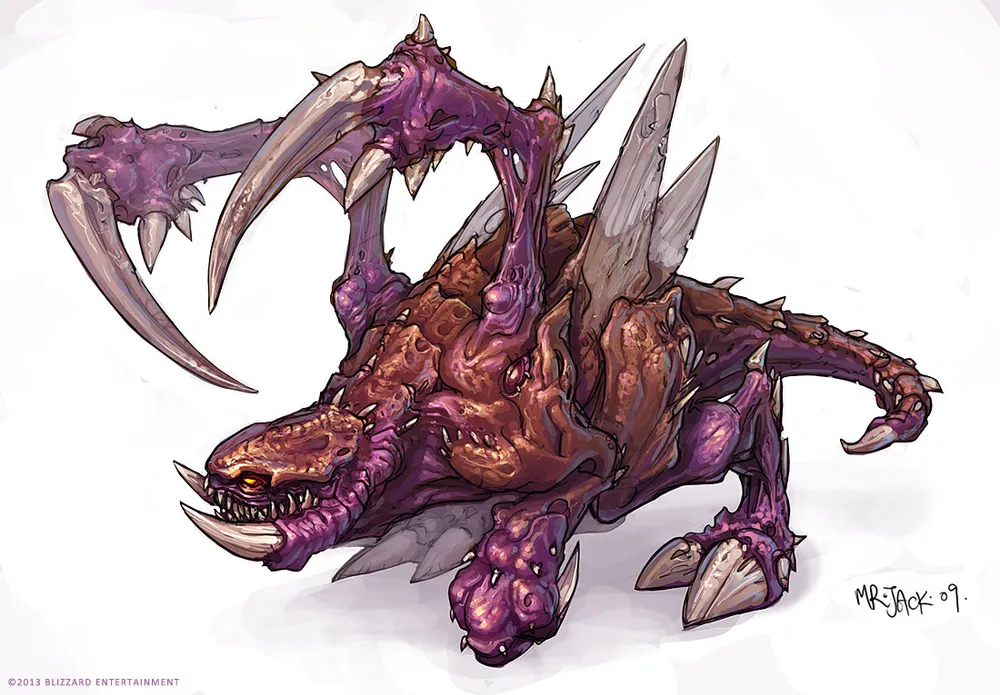
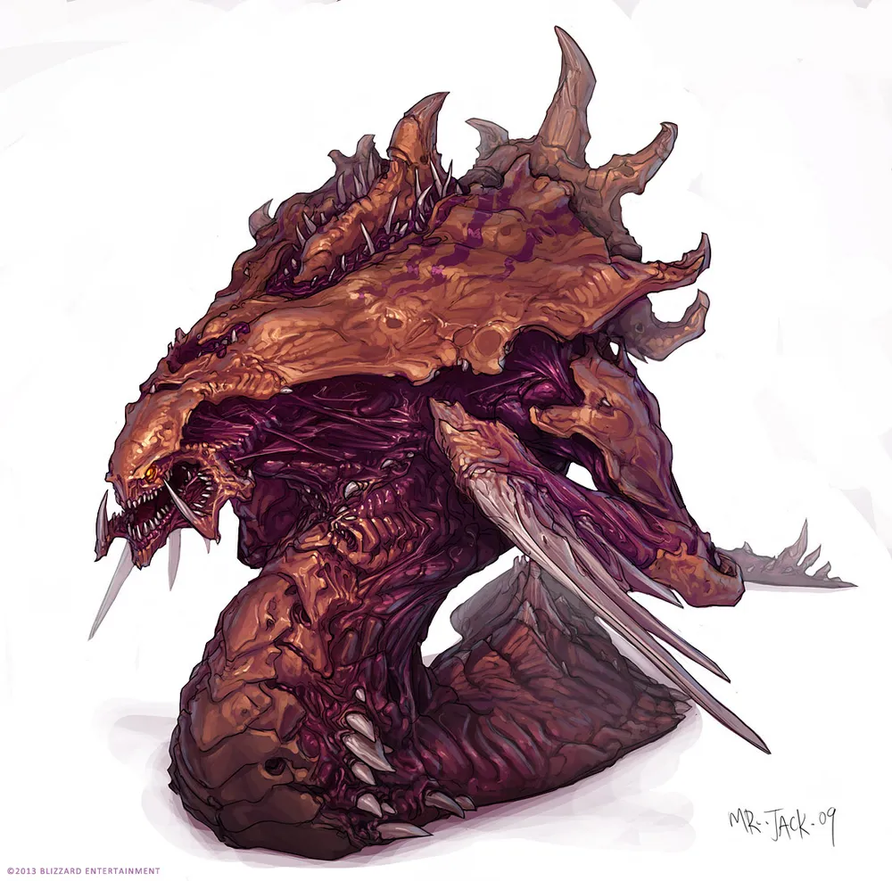
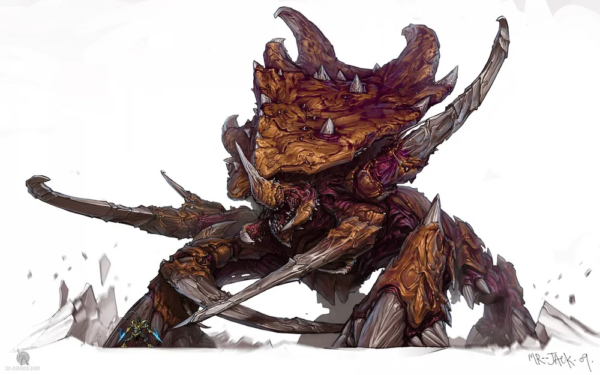
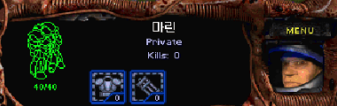

# OOOOOOO 게임 기획서
- 작성자: 김형욱
- 작성일: 2026.10.15
- 수정일1: 2026.10.22
- 수정일2:

# 개요

- 장르
- 2D 탑다운 슈팅게임
- 마린을 직접 조종

# 시스템 기획 내용
---

## 플레이 방식
- WASD - 이동
- 마우스 좌 클릭 - 총 쏘기
- 스팀팩 기능 고민 중

## 스테이지 구성
1. 전진 배럭 - 저글링 출현
2. 점막 부근 - 히드라리스크 출현
3. 해처리 - 보스몹(울트라리스크) 출현

## 캐릭터 모델
- 마린/
- 저글링/
- 히드라리스크/
- 울트라리스크/

## ui 구성
- 고증에 맞춰서 스타1을 기준으로 해당 ui에 체력 및 탄환을 표시한다. 

## 주요 클래스 다이어그램

## 주요 시퀀스 다이어그램

### 공격과 보상

## Bosmob 클래스 구성